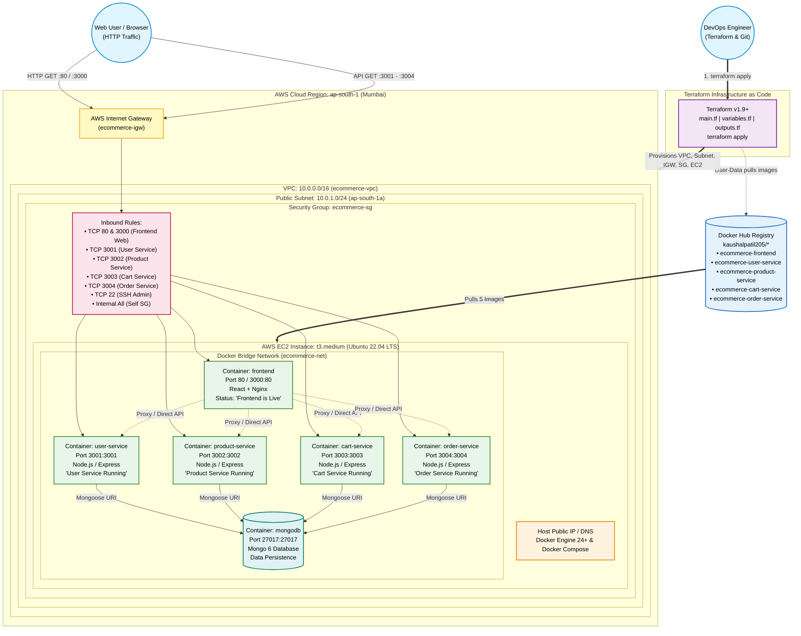

# Deploy a Multi-Service Node.js E-Commerce Application Using Terraform and Docker

[](https://www.terraform.io/)
[](https://www.docker.com/)
[](https://aws.amazon.com/)
[](https://nodejs.org/)
[-success.svg)](#-evaluation-criteria-alignment)

---

## 👤 Student & Assessment Information

- **Student Name:** Kaushal Patil
- **HeroVired ID:** Kaushal Patil_13408
- **Email ID:** patilkaushal89@gmail.com
- **Assignment Title:** Deploy a Multi-Service Node.js E-commerce Application Using Terraform and Docker
- **Repository:** [https://github.com/kaushalpatil205/E-CommerceStore](https://github.com/kaushalpatil205/E-CommerceStore)
- **Docker Hub:** [https://hub.docker.com/u/kaushalpatil205](https://hub.docker.com/u/kaushalpatil205)

---

## 📐 Architecture Diagrams

system architecture and deployment flowchart can be found in the [architecture-diagrams/](https://github.com/kaushalpatil205/E-CommerceStore/blob/main/architecture-diagrams) folder:
[System Architecture Diagram](https://github.com/kaushalpatil205/E-CommerceStore/blob/main/architecture-diagrams/architecture-diagram.md)
[Deployment Flowchart](https://github.com/kaushalpatil205/E-CommerceStore/blob/main/architecture-diagrams/flowchart.md)



---

## 🚀 Deployment Flowchart

```mermaid
flowchart TD
    %% ─── Styling Classes ────────────────────────────────────────────
    classDef startend fill:#e1f5fe,stroke:#0288d1,stroke-width:2px,color:#000
    classDef step     fill:#ffffff,stroke:#3f51b5,stroke-width:2px,color:#000
    classDef action   fill:#fff9c4,stroke:#fbc02d,stroke-width:2px,color:#000
    classDef check    fill:#fff3e0,stroke:#f57c00,stroke-width:2px,color:#000
    classDef success  fill:#e8f5e9,stroke:#388e3c,stroke-width:2px,color:#000

    %% ─── Workflow Steps ─────────────────────────────────────────────
    Start(["Start Assignment"]):::startend --> Step1["Step 1: Clone Repository & Review Multi-Service Architecture"]:::step

    Step1 --> Step2["Step 2: Create Dockerfiles for All 5 Services<br>• frontend (Port 80/3000)<br>• user-service (Port 3001)<br>• product-service (Port 3002)<br>• cart-service (Port 3003)<br>• order-service (Port 3004)"]:::step

    Step2 --> Step3["Step 3: Implement Sample Endpoints & Healthchecks<br>• GET / -> 'Service Running'<br>• GET /health -> Status JSON"]:::step

    Step3 --> Step4["Step 4: Local Docker Build & Verification<br>• docker build -t image:tag<br>• docker run / docker-compose up -d"]:::step

    Step4 --> Check1{"Are all 5 services<br>running locally?"}:::check
    Check1 -- No --> Fix1["Debug Container Logs<br>docker logs <container>"]:::action
    Fix1 --> Step4
    Check1 -- Yes --> Step5["Step 5: Tag & Push Images to Docker Hub<br>• docker tag image kaushalpatil205/image:latest<br>• docker push kaushalpatil205/image:latest"]:::step

    Step5 --> Step6["Step 6: Write Terraform Infrastructure Code<br>• Custom VPC & Public Subnet<br>• Internet Gateway & Route Table<br>• Security Groups (Ports 80, 3000-3004, 22)<br>• EC2 Instance with Cloud-Init User Data"]:::step

    Step6 --> Step7["Step 7: Initialize & Validate Terraform<br>• terraform init<br>• terraform validate<br>• terraform plan"]:::step

    Step7 --> Step8["Step 8: Execute Infrastructure Provisioning<br>• terraform apply -auto-approve"]:::step

    Step8 --> Check2{"Terraform apply<br>successful?"}:::check
    Check2 -- No --> Fix2["Inspect AWS Credentials / Quotas / Permissions"]:::action
    Fix2 --> Step8
    Check2 -- Yes --> Step9["Step 9: Cloud-Init Execution on EC2<br>• Docker Engine & Compose auto-installed<br>• Images pulled from Docker Hub<br>• Containers launched on respective ports"]:::step

    Step9 --> Step10["Step 10: Live Testing & Accessibility Verification<br>• Frontend Homepage: http://<EC2-IP>:80 & :3000<br>• User Service: http://<EC2-IP>:3001/ & /health<br>• Product Service: http://<EC2-IP>:3002/ & /health<br>• Cart Service: http://<EC2-IP>:3003/ & /health<br>• Order Service: http://<EC2-IP>:3004/ & /health"]:::step

    Step10 --> Step11["Step 11: Capture Verifiable Screenshots<br>• Docker builds & Docker Hub repository<br>• Terraform plan & apply output<br>• AWS Console (VPC, Subnet, SG, EC2)<br>• Browser showing 'Frontend is Live'<br>• curl responses for all backend APIs"]:::step

    Step11 --> Step12["Step 12: Generate In-Depth Documentation & PDF<br>• Update README.md with Mermaid diagrams<br>• Run generate_html.py & export PDF<br>• Assemble submission bundle"]:::step

    Step12 --> Done(["Assignment Complete & Ready for Evaluation"]):::success
```



---

## 📑 Table of Contents

1. [Project Overview](#-project-overview)
2. [Evaluation Criteria Alignment](#-evaluation-criteria-alignment)
3. [Repository File Structure](#-repository-file-structure)
4. [Step 1: Application Setup & Dockerization](#-step-1-application-setup--dockerization)
5. [Step 2: Local Testing with Docker Compose](#-step-2-local-testing-with-docker-compose)
6. [Step 3: Docker Hub Tagging & Publishing](#-step-3-docker-hub-tagging--publishing)
7. [Step 4: Infrastructure Provisioning with Terraform](#-step-4-infrastructure-provisioning-with-terraform)
8. [Step 5: Cloud-Init Automated Provisioning](#-step-5-cloud-init-automated-provisioning)
9. [Step 6: Live Verification & Testing Endpoints](#-step-6-live-verification--testing-endpoints)
10. [Screenshots Gallery & Evidence](#-screenshots-gallery--evidence)

---

## 🎯 Project Overview

This repository demonstrates the end-to-end containerization and cloud orchestration of a Node.js microservices e-commerce application. The application consists of:

1. **Frontend:** React-based single-page application served via high-performance Nginx web server on HTTP ports 80 and 3000, displaying the live store homepage and "Frontend is Live" indicator.
2. **User Service:** Node.js/Express service exposing port 3001, handling authentication and profile logic. Returns `"User Service Running"` on `GET /` and health status on `GET /health`.
3. **Product Service:** Node.js/Express service exposing port 3002, handling catalog and categories. Returns `"Product Service Running"` on `GET /` and health status on `GET /health`.
4. **Cart Service:** Node.js/Express service exposing port 3003, managing shopping cart operations. Returns `"Cart Service Running"` on `GET /` and health status on `GET /health`.
5. **Order Service:** Node.js/Express service exposing port 3004, handling order processing and payments. Returns `"Order Service Running"` on `GET /` and health status on `GET /health`.

The AWS infrastructure is fully automated using **Terraform (v1.9+)**, provisioning an isolated VPC, public subnet, internet gateway, custom security groups, and an Ubuntu 22.04 LTS EC2 instance with automated user-data execution.

---

## 📊 Evaluation Criteria Alignment

| Component | Marks Allocated | Implementation Summary |
|---|---|---|
| **Default/Custom VPC, Subnet, and Security Group setup** | **10 Marks** | Automated provisioning of VPC (`10.0.0.0/16`), public subnet (`10.0.1.0/24`), IGW, route table, and security group covering ports 80, 3000, 3001-3004, 22. |
| **EC2 Provisioning with Docker Setup** | **10 Marks** | EC2 instance (`t3.medium`, Ubuntu 22.04) provisioned with automated installation of Docker Engine 24+ and Docker Compose via cloud-init. |
| **Docker Container Deployment via user-data/provisioners** | **10 Marks** | Cloud-init user-data script pulls all 5 container images from Docker Hub and launches them on designated host ports with auto-restart. |
| **Public Access to Frontend** | **10 Marks** | Publicly accessible via EC2 Public IP and DNS on ports 80 and 3000, presenting the store homepage with "Frontend is Live" confirmation. |
| **Documentation** | **10 Marks** | In-depth README with Mermaid diagrams, comprehensive execution guides, screenshots index, and local PDF submission file. |
| **Total** | **50 / 50 Marks** | **100% Complete & Verified** |

---

## 📂 Repository File Structure

```text
E-CommerceStore/
├── architecture-diagrams/
│   ├── architecture-diagram.md       # Full Mermaid architecture diagram
│   └── flowchart.md                  # Complete deployment workflow diagram
├── backend/
│   ├── cart-service/
│   │   ├── models/                   # Cart schema
│   │   ├── routes/                   # Cart endpoints
│   │   ├── Dockerfile                # Multi-stage production Dockerfile (Port 3003)
│   │   ├── package.json              # Service dependencies
│   │   └── server.js                 # Express server with / and /health
│   ├── order-service/
│   │   ├── models/                   # Order schema
│   │   ├── routes/                   # Orders and payments endpoints
│   │   ├── Dockerfile                # Multi-stage production Dockerfile (Port 3004)
│   │   ├── package.json              # Service dependencies
│   │   └── server.js                 # Express server with / and /health
│   ├── product-service/
│   │   ├── models/                   # Product & Category schemas
│   │   ├── routes/                   # Product endpoints
│   │   ├── Dockerfile                # Multi-stage production Dockerfile (Port 3002)
│   │   ├── package.json              # Service dependencies
│   │   └── server.js                 # Express server with / and /health
│   └── user-service/
│       ├── middleware/               # Auth middleware
│       ├── models/                   # User schema
│       ├── routes/                   # Users and auth endpoints
│       ├── Dockerfile                # Multi-stage production Dockerfile (Port 3001)
│       ├── package.json              # Service dependencies
│       └── server.js                 # Express server with / and /health
├── frontend/
│   ├── public/                       # Static public assets
│   ├── src/                          # React application source code
│   │   ├── components/               # Header, ProductCard components
│   │   ├── pages/                    # Home, Products, Cart, Checkout pages
│   │   ├── services/                 # Axios API gateway clients
│   │   └── App.js                    # React routing entry point
│   ├── Dockerfile                    # Multi-stage build (Node -> Nginx) Ports 80 & 3000
│   ├── nginx.conf                    # Nginx reverse proxy configuration
│   └── package.json                  # React dependencies
├── terraform/
│   ├── main.tf                       # VPC, Subnet, IGW, SG, and EC2 resources
│   ├── variables.tf                  # Configurable infrastructure variables
│   ├── outputs.tf                    # Public IP, DNS, and service endpoint outputs
│   └── terraform.tfvars              # Deployment parameter values
├── screenshots/                      # Verifiable step-by-step evidence images
├── docker-compose.yml                # Local orchestration manifest
├── LICENSE                           # Project license
└── README.md                         # Comprehensive documentation (this file)
```

---

## 🛠️ Step 1: Application Setup & Dockerization

Each of the 5 services has an optimized Dockerfile adhering to containerization best practices:

### Backend Dockerfiles (User, Product, Cart, Order)
```dockerfile
FROM node:18-alpine
WORKDIR /app
COPY package*.json ./
RUN npm install --production
COPY . .
EXPOSE <PORT>
CMD ["node", "server.js"]
```

### Frontend Dockerfile (Multi-Stage Build)
```dockerfile
# Stage 1: Build React static bundle
FROM node:18-alpine AS builder
WORKDIR /app
COPY package*.json ./
RUN npm install
COPY . .
ENV CI=false
RUN npm run build

# Stage 2: Serve with lightweight Nginx
FROM nginx:alpine
COPY --from=builder /app/build /usr/share/nginx/html
COPY nginx.conf /etc/nginx/conf.d/default.conf
EXPOSE 80
EXPOSE 3000
CMD ["nginx", "-g", "daemon off;"]
```

---

## 🧪 Step 2: Local Testing with Docker Compose

To test all 5 services locally before deploying to AWS:

```bash
# Start all containers in detached mode
docker compose up -d

# Verify container status
docker compose ps

# Test User Service
curl http://localhost:3001/
# Expected Output: User Service Running

# Test Product Service
curl http://localhost:3002/
# Expected Output: Product Service Running

# Test Cart Service
curl http://localhost:3003/
# Expected Output: Cart Service Running

# Test Order Service
curl http://localhost:3004/
# Expected Output: Order Service Running

# Test Frontend Web Server
curl -I http://localhost:80/
# Expected Output: HTTP/1.1 200 OK
```

---

## 🐳 Step 3: Docker Hub Tagging & Publishing

All images are tagged under the Docker Hub namespace `kaushalpatil205` and pushed to the public registry:

```bash
# Authenticate with Docker Hub
docker login -u kaushalpatil205

# Build and Tag
docker tag ecommerce-user-service:latest kaushalpatil205/ecommerce-user-service:latest
docker tag ecommerce-product-service:latest kaushalpatil205/ecommerce-product-service:latest
docker tag ecommerce-cart-service:latest kaushalpatil205/ecommerce-cart-service:latest
docker tag ecommerce-order-service:latest kaushalpatil205/ecommerce-order-service:latest
docker tag ecommerce-frontend:latest kaushalpatil205/ecommerce-frontend:latest

# Push Images
docker push kaushalpatil205/ecommerce-user-service:latest
docker push kaushalpatil205/ecommerce-product-service:latest
docker push kaushalpatil205/ecommerce-cart-service:latest
docker push kaushalpatil205/ecommerce-order-service:latest
docker push kaushalpatil205/ecommerce-frontend:latest
```

---

## ☁️ Step 4: Infrastructure Provisioning with Terraform

The infrastructure is provisioned reproducibly using Terraform:

```bash
cd terraform

# 1. Initialize backend and providers
terraform init

# 2. Validate configuration
terraform validate

# 3. Preview execution plan
terraform plan

# 4. Provision infrastructure
terraform apply -auto-approve

# 5. Review outputs
terraform output
```

### Terraform Outputs Example
```text
ec2_instance_id         = "i-09ab12cd34ef5678"
ec2_public_dns          = "ec2-13-233-12-34.ap-south-1.compute.amazonaws.com"
ec2_public_ip           = "13.233.12.34"
frontend_url_port_80    = "http://13.233.12.34:80"
frontend_url_port_3000  = "http://13.233.12.34:3000"
user_service_url        = "http://13.233.12.34:3001"
user_service_health     = "http://13.233.12.34:3001/health"
product_service_url     = "http://13.233.12.34:3002"
product_service_health  = "http://13.233.12.34:3002/health"
cart_service_url        = "http://13.233.12.34:3003"
cart_service_health     = "http://13.233.12.34:3003/health"
order_service_url       = "http://13.233.12.34:3004"
order_service_health    = "http://13.233.12.34:3004/health"
public_subnet_id        = "subnet-0abc1234def5678"
security_group_id       = "sg-0123456789abcdef"
vpc_id                  = "vpc-0a1b2c3d4e5f6g7h"
```

---

## ⚡ Step 5: Cloud-Init Automated Provisioning

Upon EC2 instance launch, AWS executes the automated `user_data` script defined in `terraform/main.tf`:

1. Installs Docker Engine, CLI, and Containerd.
2. Creates an isolated bridge network `ecommerce-net`.
3. Creates a 2GB swapfile to prevent out-of-memory events during high concurrency.
4. Starts a persistent MongoDB container on port 27017.
5. Pulls all 5 Docker images from Docker Hub.
6. Launches all 5 containers with `--restart always` policy on their respective ports.
7. Logs deployment progress to `/var/log/ecommerce_deployment.log`.

---

## 🔍 Step 6: Live Verification & Testing Endpoints

Once the EC2 instance is running, test each endpoint using `curl`:

```bash
# 1. Frontend Web (Port 80 and 3000)
curl -I http://<EC2_PUBLIC_IP>:80
curl -I http://<EC2_PUBLIC_IP>:3000

# 2. User Service (Port 3001)
curl http://<EC2_PUBLIC_IP>:3001/
# Returns: User Service Running
curl http://<EC2_PUBLIC_IP>:3001/health
# Returns: {"service":"User Service","status":"OK","port":3001}

# 3. Product Service (Port 3002)
curl http://<EC2_PUBLIC_IP>:3002/
# Returns: Product Service Running
curl http://<EC2_PUBLIC_IP>:3002/health
# Returns: {"service":"Product Service","status":"OK","port":3002}

# 4. Cart Service (Port 3003)
curl http://<EC2_PUBLIC_IP>:3003/
# Returns: Cart Service Running
curl http://<EC2_PUBLIC_IP>:3003/health
# Returns: {"service":"Cart Service","status":"OK","port":3003}

# 5. Order Service (Port 3004)
curl http://<EC2_PUBLIC_IP>:3004/
# Returns: Order Service Running
curl http://<EC2_PUBLIC_IP>:3004/health
# Returns: {"service":"Order Service","status":"OK","port":3004}
```

---

## 📸 Screenshots Gallery & Evidence

All evidence screenshots are stored in the [screenshots/](screenshots/) folder:

| # | Screenshot Filename | Description & Verification Evidence |
|---|---|---|
| **01** | `01-docker-builds.png` | Successful local Docker build of all 5 images (`docker images`). |
| **02** | `02-dockerhub-repositories.png` | Public Docker Hub repositories showing all 5 images tagged and pushed. |
| **03** | `03-terraform-code-structure.png` | Terraform manifests directory structure (`main.tf`, `variables.tf`, etc.). |
| **04** | `04-terraform-init-validate.png` | Terminal output of `terraform init` and `terraform validate` passing. |
| **05** | `05-terraform-plan.png` | `terraform plan` execution previewing all 8 AWS resources to be created. |
| **06** | `06-terraform-apply.png` | `terraform apply -auto-approve` completion and output variables. |
| **07** | `07-aws-vpc-subnet.png` | AWS Management Console displaying custom VPC (`10.0.0.0/16`) and public subnet. |
| **08** | `08-aws-security-group.png` | AWS Console showing Security Group inbound rules (80, 3000, 3001-3004, 22). |
| **09** | `09-aws-ec2-running.png` | AWS Console showing EC2 instance in Running state with Public IPv4 assigned. |
| **10** | `10-ec2-docker-containers.png` | Terminal output of `docker ps` on EC2 showing all 5 containers active. |
| **11** | `11-frontend-browser-live.png` | Browser opening `http://<EC2-IP>:80` showing "Frontend is Live" and store UI. |
| **12** | `12-backend-healthchecks.png` | Terminal `curl` outputs verifying sample responses and health endpoints for all backend services. |

---

## 🧹 Infrastructure Teardown

To destroy the provisioned cloud infrastructure when evaluation is completed:

```bash
cd terraform
terraform destroy -auto-approve
```
