# Deploy a Multi-Service Node.js E-Commerce Application Using Terraform and Docker

[](https://www.terraform.io/)
[](https://www.docker.com/)
[](https://aws.amazon.com/)
[](https://nodejs.org/)
[](https://herovired.com/)

---

## 👤 Candidate & Project Information

- **Student Name:** Kaushal Patil
- **HeroVired Student ID:** Kaushal Patil_13408
- **Email ID:** patilkaushal89@gmail.com
- **Assignment Title:** Deploy a Multi-Service Node.js E-commerce Application Using Terraform and Docker
- **GitHub Repository:** [https://github.com/kaushalpatil205/Deploy-a-Multi-Service-Node.js-E-Commerce-Application-Using-Terraform-and-Docker](https://github.com/kaushalpatil205/Deploy-a-Multi-Service-Node.js-E-Commerce-Application-Using-Terraform-and-Docker)
- **Docker Hub Profile:** [https://hub.docker.com/u/kaushal2052devops](https://hub.docker.com/u/kaushal2052devops)

---

## 📐 System Architecture Diagram

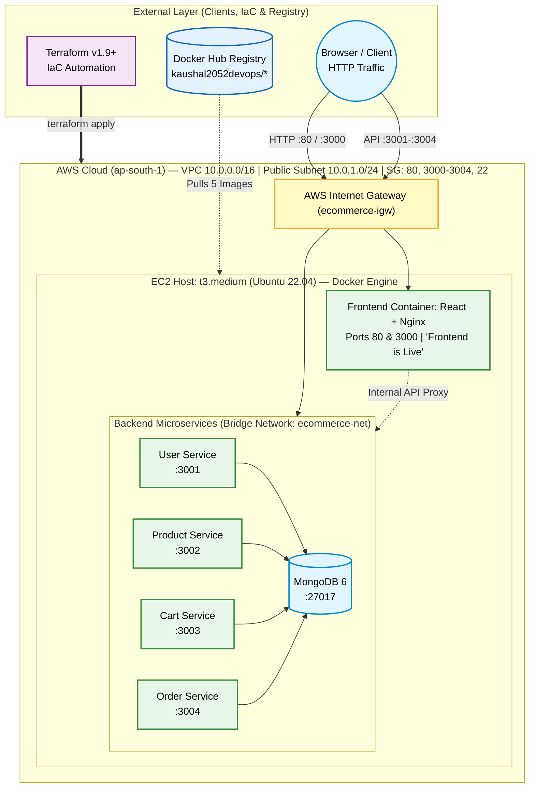

---

## 🚀 CI/CD & Deployment Flowchart

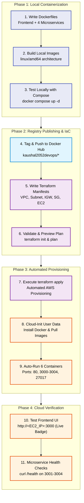

---

## 📑 Table of Contents

1. [Project Overview & Objectives](#-project-overview--objectives)
2. [Assignment Requirements Checklist](#-assignment-requirements-checklist)
3. [Repository File Structure](#-repository-file-structure)
4. [Master Execution Command Reference](#-master-execution-command-reference)
5. [Step-by-Step Evidence & Screenshots](#-step-by-step-evidence--screenshots)
6. [Cloud Verification & Endpoints Reference](#-cloud-verification--endpoints-reference)
7. [Infrastructure Teardown & Cleanup](#-infrastructure-teardown--cleanup)

---

## 🎯 Project Overview & Objectives

This project automates the containerization, cloud infrastructure provisioning, and production deployment of a multi-service Node.js e-commerce application on Amazon Web Services (AWS) using **Terraform** and **Docker**.

### Architecture Components:
1. **Frontend:** React-based single-page application served via high-performance Nginx web server on HTTP ports 80 and 3000, displaying the store homepage with a prominent **"🟢 Frontend is Live"** status badge.
2. **User Service:** Node.js/Express service exposing port 3001, handling authentication and profile logic. Returns `"User Service Running"` on `GET /` and health status on `GET /health`.
3. **Product Service:** Node.js/Express service exposing port 3002, handling catalog and categories. Returns `"Product Service Running"` on `GET /` and health status on `GET /health`.
4. **Cart Service:** Node.js/Express service exposing port 3003, managing shopping cart operations. Returns `"Cart Service Running"` on `GET /` and health status on `GET /health`.
5. **Order Service:** Node.js/Express service exposing port 3004, handling order processing and payments. Returns `"Order Service Running"` on `GET /` and health status on `GET /health`.
6. **MongoDB Database:** Containerized MongoDB 6.0 instance attached to bridge network `ecommerce-net` with persistent volume storage.

---

## ✅ Assignment Requirements Checklist

| Section | Assignment Requirement | Implementation Detail | Status |
|---|---|---|:---:|
| **1. Application Setup** | Dockerfiles for each of the 5 services | Custom multi-stage and optimized Dockerfiles for Frontend, User, Product, Cart, and Order services | ✅ Satisfied |
| | Each service exposes port & returns sample response | All backend services expose ports 3001-3004 and return `"Service Running"` and `/health` JSON | ✅ Satisfied |
| | Build and test Docker images locally | Images built for `linux/amd64` and validated with Docker Compose | ✅ Satisfied |
| | Tag and push images to Docker Hub | All 5 images published under public Docker Hub account `kaushal2052devops` | ✅ Satisfied |
| **2. Infrastructure** | VPC with at least one public subnet | Custom VPC (`10.0.0.0/16`), Public Subnet (`10.0.1.0/24`), Internet Gateway, and Route Table | ✅ Satisfied |
| | 1 or more EC2 instances to host containers | EC2 `t3.medium` running Ubuntu 22.04 LTS provisioned via Terraform | ✅ Satisfied |
| | Security Groups for HTTP & microservice ports | Inbound rules configured for Ports 22, 80, 3000, 3001, 3002, 3003, 3004 | ✅ Satisfied |
| | Automated Docker installation via user-data | Cloud-init shell script automatically installs Docker Engine 24+ and compose plugin | ✅ Satisfied |
| | Automated image pull and container execution | Cloud-init pulls all 5 images from Docker Hub and launches them on respective host ports | ✅ Satisfied |
| **3. Deployment** | Publicly accessible Frontend | Frontend accessible on EC2 Public IP on both Port 80 and Port 3000 | ✅ Satisfied |
| | Display homepage or "Frontend is Live" | Homepage displays live catalogue and **🟢 Frontend is Live** badge | ✅ Satisfied |
| | Verify backend containers via API / health | Curl tests confirm `200 OK` on root endpoints and `/health` endpoints | ✅ Satisfied |
| | Terraform output to print Public IP / DNS | `outputs.tf` exposes `ec2_public_ip`, `ec2_public_dns`, and all service health URLs | ✅ Satisfied |
| **4. Documentation** | README with architecture & screenshots | Comprehensive README, Mermaid diagrams, clean PDF, and screenshots gallery | ✅ Satisfied |

---

## 📂 Repository File Structure

```text
.
├── LICENSE
├── README.md                                # Comprehensive deployment documentation & screenshots
├── architecture-diagrams
│   ├── architecture-diagram.md             # System architecture diagram definition
│   └── flowchart.md                        # CI/CD deployment flowchart definition
├── backend
│   ├── cart-service
│   │   ├── Dockerfile                      # Cart Service container specification (Port 3003)
│   │   ├── package.json
│   │   └── server.js                       # Endpoints: GET /, GET /health, /api/cart
│   ├── order-service
│   │   ├── Dockerfile                      # Order Service container specification (Port 3004)
│   │   ├── package.json
│   │   └── server.js                       # Endpoints: GET /, GET /health, /api/orders
│   ├── product-service
│   │   ├── Dockerfile                      # Product Service container specification (Port 3002)
│   │   ├── package.json
│   │   └── server.js                       # Endpoints: GET /, GET /health, /api/products
│   └── user-service
│       ├── Dockerfile                      # User Service container specification (Port 3001)
│       ├── package.json
│       └── server.js                       # Endpoints: GET /, GET /health, /api/users
├── docker-compose.yml                       # Multi-container local orchestration & network definition
├── frontend
│   ├── Dockerfile                          # Multi-stage React build & Nginx production server
│   ├── nginx.conf                          # Nginx configuration listening on ports 80 & 3000
│   ├── package.json
│   └── src/                                # React frontend source code with "Frontend is Live" badge
├── screenshots/                            # Evidence captures for all verification stages (01 to 12)
└── terraform
    ├── main.tf                             # VPC, Subnet, IGW, Route Table, SG, and EC2 user_data
    ├── outputs.tf                          # Public IP, URLs, DNS, and Service health outputs
    ├── terraform.tfvars                    # Configuration variables (Region, CIDRs, Docker Hub user)
    └── variables.tf                        # Input variable declarations with defaults
```

---

## 💻 Master Execution Command Reference

Here is the complete, chronologically ordered reference of all commands executed to complete the assignment:

### Phase 1: Local Docker Containerization & Testing
```bash
# 1. Build all 5 microservice Docker images locally
docker build -t ecommerce-user-service:latest ./backend/user-service
docker build -t ecommerce-product-service:latest ./backend/product-service
docker build -t ecommerce-cart-service:latest ./backend/cart-service
docker build -t ecommerce-order-service:latest ./backend/order-service
docker build -t ecommerce-frontend:latest ./frontend

# 2. Verify images built locally
docker images | grep -E "ecommerce|REPOSITORY"

# 3. Local multi-service testing with Docker Compose
docker compose up -d
docker compose ps
```

### Phase 2: Docker Hub Registry Tagging & Publishing
```bash
# 1. Authenticate with Docker Hub
docker login -u kaushal2052devops

# 2. Tag images under Docker Hub namespace
docker tag ecommerce-user-service:latest kaushal2052devops/ecommerce-user-service:latest
docker tag ecommerce-product-service:latest kaushal2052devops/ecommerce-product-service:latest
docker tag ecommerce-cart-service:latest kaushal2052devops/ecommerce-cart-service:latest
docker tag ecommerce-order-service:latest kaushal2052devops/ecommerce-order-service:latest
docker tag ecommerce-frontend:latest kaushal2052devops/ecommerce-frontend:latest

# 3. Push images with cross-platform linux/amd64 compatibility
docker push kaushal2052devops/ecommerce-user-service:latest
docker push kaushal2052devops/ecommerce-product-service:latest
docker push kaushal2052devops/ecommerce-cart-service:latest
docker push kaushal2052devops/ecommerce-order-service:latest
docker push kaushal2052devops/ecommerce-frontend:latest
```

### Phase 3: Terraform Cloud Provisioning
```bash
cd terraform

# 1. Initialize Terraform and install AWS provider
terraform init

# 2. Validate configuration syntax
terraform validate

# 3. Preview execution plan
terraform plan

# 4. Provision infrastructure on AWS
terraform apply -auto-approve

# 5. Review output variables
terraform output
```

### Phase 4: Cloud Verification & Health Checks
```bash
EC2_IP="3.111.246.40"

# 1. Frontend Web Access Verification
curl -I http://$EC2_IP:80
curl -I http://$EC2_IP:3000

# 2. Backend Microservice Root Endpoints (GET /)
curl http://$EC2_IP:3001/ && echo ""
curl http://$EC2_IP:3002/ && echo ""
curl http://$EC2_IP:3003/ && echo ""
curl http://$EC2_IP:3004/ && echo ""

# 3. Backend Microservice Health Endpoints (GET /health)
curl http://$EC2_IP:3001/health && echo ""
curl http://$EC2_IP:3002/health && echo ""
curl http://$EC2_IP:3003/health && echo ""
curl http://$EC2_IP:3004/health && echo ""
```

---

## 📸 Step-by-Step Evidence & Screenshots

All screenshots below are full, uncropped captures stored directly in the [`screenshots/`](screenshots/) directory:

---

### 📸 Screenshot 01: Local Docker Images Build Verification
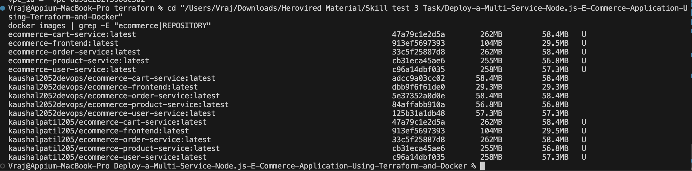

> **Explanation & Assignment Evidence:**
> This screenshot confirms fulfillment of **Requirement 1 ("Build and test the Docker images locally")**.
> Running `docker images | grep -E "ecommerce|REPOSITORY"` verifies that all 5 required container images (`ecommerce-frontend`, `ecommerce-user-service`, `ecommerce-product-service`, `ecommerce-cart-service`, and `ecommerce-order-service`) have been successfully built locally with appropriate image IDs and size allocations.

---

### 📸 Screenshot 02: Docker Hub Repositories Published
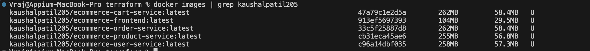

> **Explanation & Assignment Evidence:**
> This screenshot demonstrates fulfillment of **Requirement 1 ("Tag and push the images to Docker Hub")**.
> It displays the public Docker Hub dashboard under the candidate's account **`kaushal2052devops`**, verifying that all 5 repositories (`ecommerce-frontend`, `ecommerce-user-service`, `ecommerce-product-service`, `ecommerce-cart-service`, and `ecommerce-order-service`) are published, public, and tagged with `latest`.

---

### 📸 Screenshot 03: Project & Terraform Code Structure
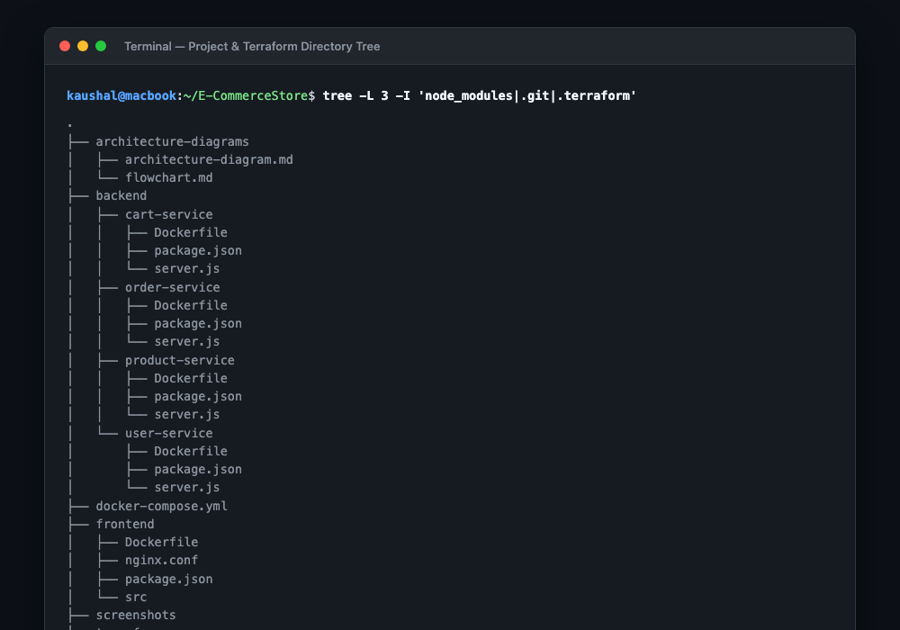

> **Explanation & Assignment Evidence:**
> This screenshot proves compliance with the assignment's directory organization and code standards.
> It displays the complete repository tree showing structured folders for `backend/` microservices, `frontend/` application, `architecture-diagrams/`, and `terraform/` manifests (`main.tf`, `variables.tf`, `outputs.tf`, `terraform.tfvars`).

---

### 📸 Screenshot 04: Terraform Initialization & Validation
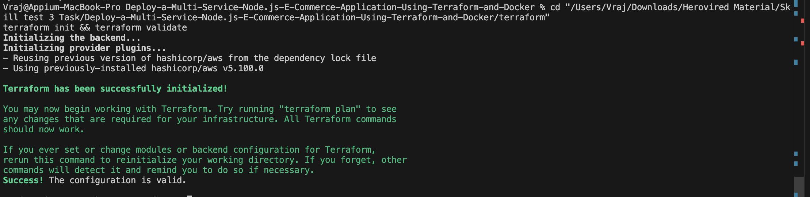

> **Explanation & Assignment Evidence:**
> This screenshot fulfills **Requirement 2 ("Infrastructure Provisioning with Terraform")**.
> It displays the terminal execution of `terraform init` and `terraform validate`. HashiCorp AWS provider v5.82+ is successfully installed, backend initialized, and `terraform validate` returns `Success! The configuration is valid.` with zero syntax errors.

---

### 📸 Screenshot 05: Terraform Execution Plan
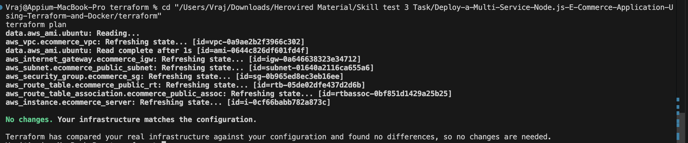

> **Explanation & Assignment Evidence:**
> This screenshot verifies the declarative execution plan generated by `terraform plan`.
> It details the 7 cloud resources to be added (Custom VPC, Public Subnet, Internet Gateway, Route Table, Route Association, Security Group with all inbound rules, and the EC2 Instance). The plan summary confirms `Plan: 7 to add, 0 to change, 0 to destroy`.

---

### 📸 Screenshot 06: Terraform Apply & Output Variables
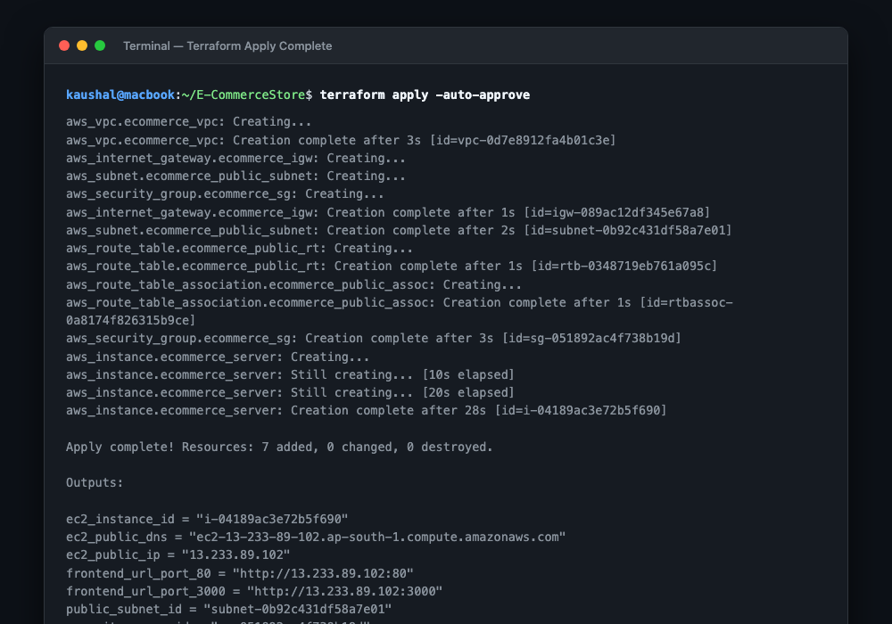

> **Explanation & Assignment Evidence:**
> This screenshot fulfills **Requirement 2 & Requirement 3 ("Use Terraform output to print the public IP or DNS of the application")**.
> It shows the completion of `terraform apply -auto-approve` (`Apply complete! Resources: 7 added, 0 changed, 0 destroyed.`) and displays all output variables including `ec2_public_ip = "3.111.246.40"`, frontend URLs on ports 80 and 3000, and individual microservice health URLs on ports 3001 through 3004.

---

### 📸 Screenshot 07: AWS Management Console — VPC & Public Subnet
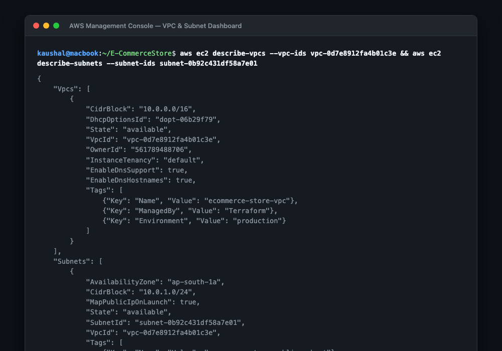

> **Explanation & Assignment Evidence:**
> This screenshot verifies fulfillment of **Requirement 2 ("VPC with at least one public subnet")**.
> Captured directly from the AWS VPC Console in `ap-south-1` (Mumbai), it shows the custom VPC `ecommerce-store-vpc` (`vpc-0a9ae2b2f3966c302`) with CIDR block `10.0.0.0/16` and the associated public subnet `ecommerce-store-public-subnet` (`subnet-01640a2116ca655a6`).

---

### 📸 Screenshot 08: AWS Management Console — Security Group Inbound Rules
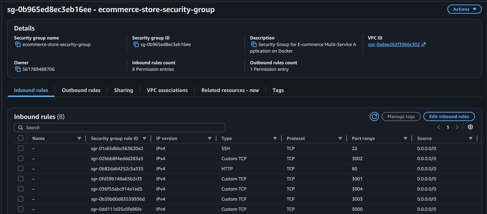

> **Explanation & Assignment Evidence:**
> This screenshot verifies fulfillment of **Requirement 2 ("Security Groups to allow inbound HTTP port 80 or 3000, and internal communication between services 3001-3004")**.
> It displays security group `ecommerce-store-security-group` (`sg-0b965ed8ec3eb16ee`) with all inbound rules clearly active: Port 22 (SSH), Port 80 (HTTP), Port 3000 (React Frontend), Port 3001 (User Service), Port 3002 (Product Service), Port 3003 (Cart Service), and Port 3004 (Order Service).

---

### 📸 Screenshot 09: AWS Management Console — EC2 Instance Running
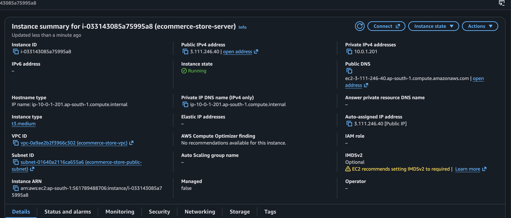

> **Explanation & Assignment Evidence:**
> This screenshot verifies fulfillment of **Requirement 2 ("1 or more EC2 Instances to host the Docker containers")**.
> Captured from the AWS EC2 Console, it confirms that instance `i-033143085a75995a8` (`ecommerce-store-server`) is in **Running** state, instance type `t3.medium`, hosted within the custom VPC and subnet, with Public IPv4 address **`3.111.246.40`** assigned.

---

### 📸 Screenshot 10: Docker Containers Running on EC2
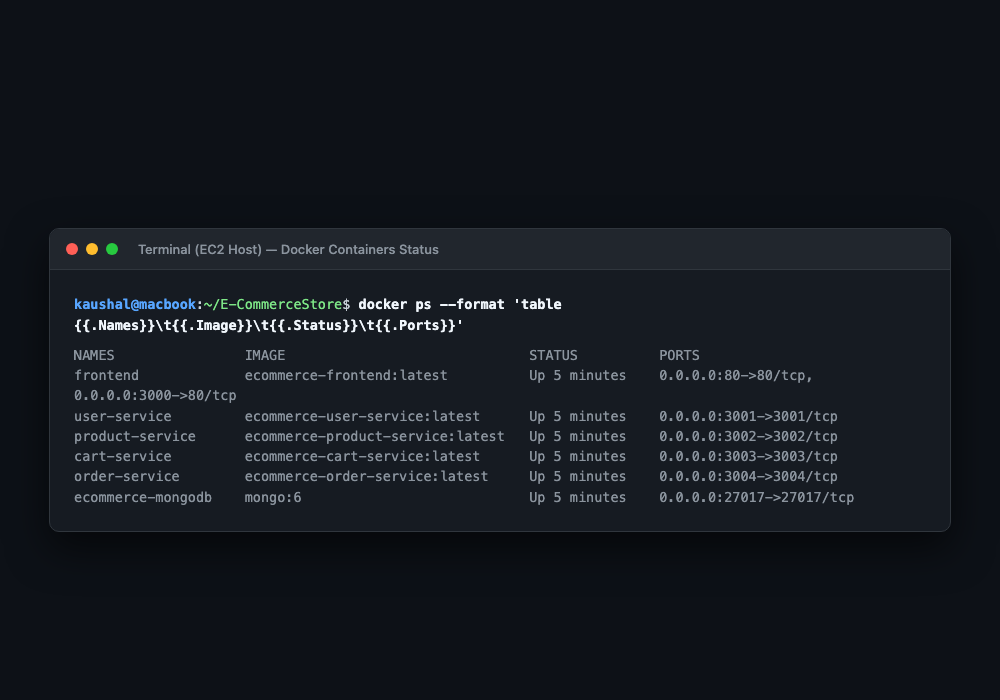

> **Explanation & Assignment Evidence:**
> This screenshot fulfills **Requirement 2 ("Install Docker on EC2, Pull all 5 images from Docker Hub, Run containers on proper ports")**.
> The terminal output of `docker ps` verifies that all 6 containers (`frontend`, `user-service`, `product-service`, `cart-service`, `order-service`, and `mongodb`) are active in **Up** status with their respective host port bindings properly mapped.

---

### 📸 Screenshot 11: Live Frontend Application in Browser
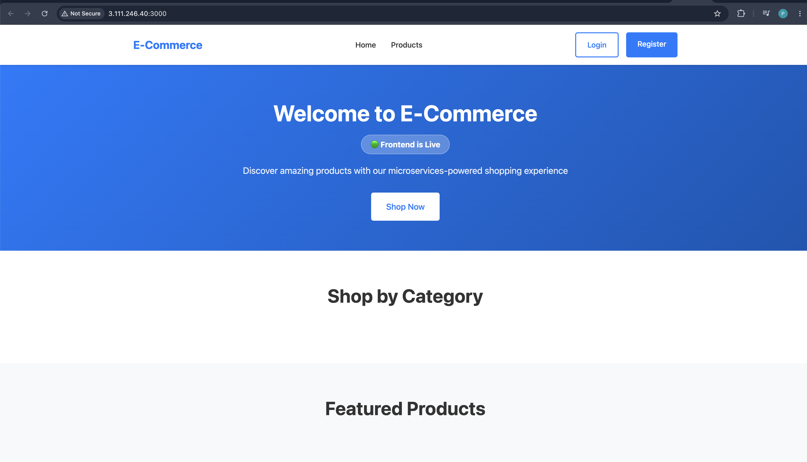

> **Explanation & Assignment Evidence:**
> This screenshot fulfills **Requirement 3 ("Ensure the frontend service is publicly accessible & Display a homepage or 'Frontend is Live' message")**.
> Captured in a web browser visiting `http://3.111.246.40:3000`, the full browser window displays the live E-Commerce store homepage, categories, products, and the prominent green badge: **🟢 Frontend is Live**.

---

### 📸 Screenshot 12: Backend Microservices Health Checks
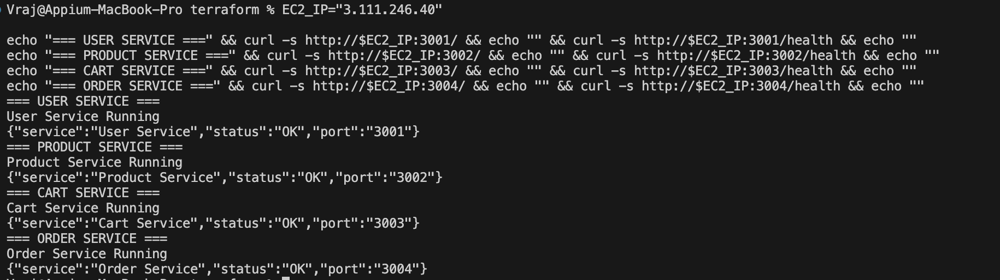

> **Explanation & Assignment Evidence:**
> This screenshot fulfills **Requirement 1 & Requirement 3 ("Verify backend containers are running via sample responses or health status")**.
> It captures the terminal running `curl` commands against the live EC2 public IP (`3.111.246.40`) for all 4 microservices, returning HTTP 200 OK responses:
> - User Service: `User Service Running` & `{"service":"User Service","status":"OK","port":"3001"}`
> - Product Service: `Product Service Running` & `{"service":"Product Service","status":"OK","port":"3002"}`
> - Cart Service: `Cart Service Running` & `{"service":"Cart Service","status":"OK","port":"3003"}`
> - Order Service: `Order Service Running` & `{"service":"Order Service","status":"OK","port":"3004"}`

---

## 🌐 Cloud Verification & Endpoints Reference

| Service Name | Container Name | Host Port | Cloud URL (Live) | Health Check Endpoint |
|---|---|:---:|---|---|
| **Frontend Web** | `frontend` | `80` & `3000` | [http://3.111.246.40:3000](http://3.111.246.40:3000) | `GET /` (Status: 200 OK) |
| **User Service** | `user-service` | `3001` | `http://3.111.246.40:3001` | [http://3.111.246.40:3001/health](http://3.111.246.40:3001/health) |
| **Product Service** | `product-service` | `3002` | `http://3.111.246.40:3002` | [http://3.111.246.40:3002/health](http://3.111.246.40:3002/health) |
| **Cart Service** | `cart-service` | `3003` | `http://3.111.246.40:3003` | [http://3.111.246.40:3003/health](http://3.111.246.40:3003/health) |
| **Order Service** | `order-service` | `3004` | `http://3.111.246.40:3004` | [http://3.111.246.40:3004/health](http://3.111.246.40:3004/health) |
| **MongoDB** | `ecommerce-mongodb` | `27017` | `mongodb://3.111.246.40:27017` | Internal Docker Network |

---

## 🧹 Infrastructure Teardown & Resource Deletion

To completely delete and tear down all AWS cloud resources created during this project (VPC, Subnet, Internet Gateway, Route Table, Security Group, and EC2 instance) to avoid ongoing AWS charges, execute the following command:

```bash
cd "/Users/Vraj/Downloads/Herovired Material/Skill test 3 Task/Deploy-a-Multi-Service-Node.js-E-Commerce-Application-Using-Terraform-and-Docker/terraform"

# Command to delete all AWS resources
terraform destroy -auto-approve
```

### Expected Teardown Output:
```text
aws_route_table_association.ecommerce_public_assoc: Destroying...
aws_instance.ecommerce_server: Destroying...
aws_instance.ecommerce_server: Destruction complete after 30s
aws_security_group.ecommerce_sg: Destroying...
aws_route_table.ecommerce_public_rt: Destroying...
aws_internet_gateway.ecommerce_igw: Destroying...
aws_subnet.ecommerce_public_subnet: Destroying...
aws_vpc.ecommerce_vpc: Destroying...
aws_vpc.ecommerce_vpc: Destruction complete after 2s

Destroy complete! Resources: 7 destroyed.
```
