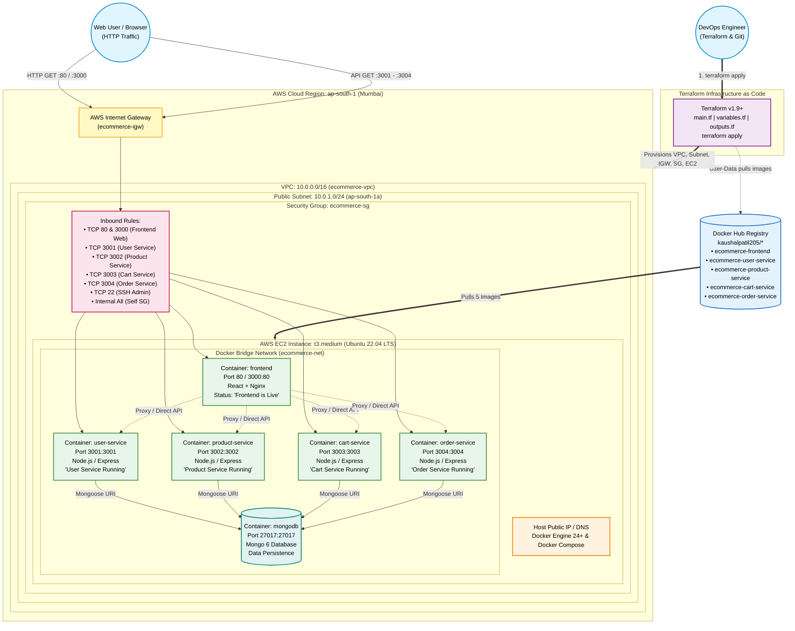

# 📐 Multi-Service E-Commerce System Architecture

This document details the complete end-to-end cloud and container architecture for the Node.js Multi-Service E-Commerce Application provisioned on AWS using Terraform and Docker.

---

## Architecture Diagram (Mermaid)

---

## 🏛️ Architecture Highlights

| Layer | Component | Implementation Details |
|---|---|---|
| **Cloud Provider** | AWS (Amazon Web Services) | Region: `ap-south-1` (Mumbai) |
| **Network (VPC)** | Custom VPC | CIDR: `10.0.0.0/16`, DNS Hostnames Enabled |
| **Subnet** | Public Subnet | CIDR: `10.0.1.0/24`, AZ: `ap-south-1a`, Auto-assign Public IP |
| **Routing** | Internet Gateway & Route Table | Route `0.0.0.0/0` targeting IGW for two-way public Internet access |
| **Firewall (SG)** | `ecommerce-sg` | Allows Inbound 80, 3000, 3001, 3002, 3003, 3004, 22 and internal SG traffic |
| **Compute** | AWS EC2 `t3.medium` | 2 vCPUs, 4 GB RAM, 25 GB gp3 root storage, Ubuntu 22.04 LTS |
| **Container Engine**| Docker & Docker Compose | Container isolation on user-defined bridge network `ecommerce-net` |
| **Frontend** | React + Nginx | Multi-stage build, static serving on ports 80 and 3000, API reverse-proxying |
| **User Service** | Node.js Express (`user-service`) | Port 3001, handles user profiles, auth JWT, healthcheck `/health` |
| **Product Service**| Node.js Express (`product-service`)| Port 3002, product catalog, categories, inventory management |
| **Cart Service** | Node.js Express (`cart-service`) | Port 3003, active user cart, item addition and validation |
| **Order Service** | Node.js Express (`order-service`) | Port 3004, order processing, payments gateway simulation |
| **Database** | MongoDB 6 Container | Port 27017, internal persistence volume for catalog and order data |
