# 🚀 Multi-Service E-Commerce Deployment Flowchart

This document details the complete end-to-end deployment workflow for containerizing the microservices, pushing to Docker Hub, provisioning cloud infrastructure via Terraform, and verifying live services.

---

## Deployment Flowchart (Mermaid)

```mermaid
flowchart TD
    %% ─── Styling Classes ────────────────────────────────────────────
    classDef startend fill:#e1f5fe,stroke:#0288d1,stroke-width:2px,color:#000
    classDef step     fill:#ffffff,stroke:#3f51b5,stroke-width:2px,color:#000
    classDef action   fill:#fff9c4,stroke:#fbc02d,stroke-width:2px,color:#000
    classDef check    fill:#fff3e0,stroke:#f57c00,stroke-width:2px,color:#000
    classDef success  fill:#e8f5e9,stroke:#388e3c,stroke-width:2px,color:#000

    %% ─── Workflow Steps ─────────────────────────────────────────────
    Start(["Start Assignment"]):::startend --> Step1["Step 1: Clone Repository & Review Multi-Service Architecture"]:::step

    Step1 --> Step2["Step 2: Create Dockerfiles for All 5 Services<br>• frontend (Port 80/3000)<br>• user-service (Port 3001)<br>• product-service (Port 3002)<br>• cart-service (Port 3003)<br>• order-service (Port 3004)"]:::step

    Step2 --> Step3["Step 3: Implement Sample Endpoints & Healthchecks<br>• GET / -> 'Service Running'<br>• GET /health -> Status JSON"]:::step

    Step3 --> Step4["Step 4: Local Docker Build & Verification<br>• docker build -t image:tag<br>• docker run / docker-compose up -d"]:::step

    Step4 --> Check1{"Are all 5 services<br>running locally?"}:::check
    Check1 -- No --> Fix1["Debug Container Logs<br>docker logs <container>"]:::action
    Fix1 --> Step4
    Check1 -- Yes --> Step5["Step 5: Tag & Push Images to Docker Hub<br>• docker tag image kaushalpatil205/image:latest<br>• docker push kaushalpatil205/image:latest"]:::step

    Step5 --> Step6["Step 6: Write Terraform Infrastructure Code<br>• Custom VPC & Public Subnet<br>• Internet Gateway & Route Table<br>• Security Groups (Ports 80, 3000-3004, 22)<br>• EC2 Instance with Cloud-Init User Data"]:::step

    Step6 --> Step7["Step 7: Initialize & Validate Terraform<br>• terraform init<br>• terraform validate<br>• terraform plan"]:::step

    Step7 --> Step8["Step 8: Execute Infrastructure Provisioning<br>• terraform apply -auto-approve"]:::step

    Step8 --> Check2{"Terraform apply<br>successful?"}:::check
    Check2 -- No --> Fix2["Inspect AWS Credentials / Quotas / Permissions"]:::action
    Fix2 --> Step8
    Check2 -- Yes --> Step9["Step 9: Cloud-Init Execution on EC2<br>• Docker Engine & Compose auto-installed<br>• Images pulled from Docker Hub<br>• Containers launched on respective ports"]:::step

    Step9 --> Step10["Step 10: Live Testing & Accessibility Verification<br>• Frontend Homepage: http://<EC2-IP>:80 & :3000<br>• User Service: http://<EC2-IP>:3001/ & /health<br>• Product Service: http://<EC2-IP>:3002/ & /health<br>• Cart Service: http://<EC2-IP>:3003/ & /health<br>• Order Service: http://<EC2-IP>:3004/ & /health"]:::step

    Step10 --> Step11["Step 11: Capture Verifiable Screenshots<br>• Docker builds & Docker Hub repository<br>• Terraform plan & apply output<br>• AWS Console (VPC, Subnet, SG, EC2)<br>• Browser showing 'Frontend is Live'<br>• curl responses for all backend APIs"]:::step

    Step11 --> Step12["Step 12: Generate In-Depth Documentation & PDF<br>• Update README.md with Mermaid diagrams<br>• Run generate_html.py & export PDF<br>• Assemble submission bundle"]:::step

    Step12 --> Done(["Assignment Complete & Ready for Evaluation"]):::success
```

---

## 📋 Deployment Stages Breakdown

1. **Source & Code Architecture**: 4 independent Node.js backend microservices and 1 React frontend.
2. **Containerization**: Optimized Dockerfiles with production builds and lightweight Alpine bases.
3. **Registry Distribution**: Images pushed to Docker Hub with public accessibility for cloud deployment.
4. **Infrastructure as Code (IaC)**: Fully automated AWS resource orchestration with zero manual console clicking required.
5. **Automated Provisioning**: Cloud-init script automatically bootstraps Docker and container instances upon EC2 boot.
6. **Validation**: Comprehensive multi-port HTTP probing to confirm both frontend UI and microservice APIs are responding.
