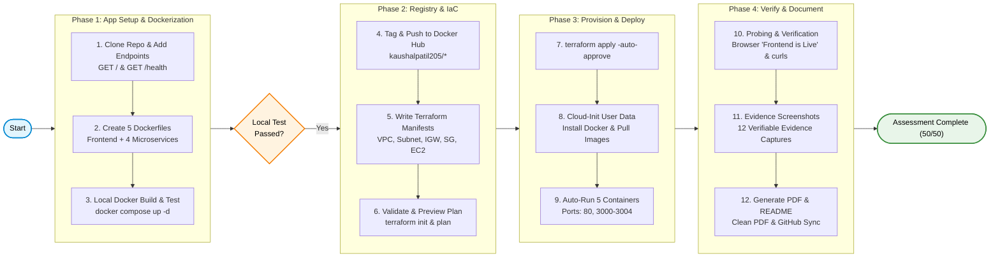

# 🚀 Multi-Service E-Commerce Deployment Flowchart

This document details the deployment workflow for containerizing the microservices, pushing to Docker Hub, provisioning cloud infrastructure via Terraform, and verifying live services.

---

## Deployment Flowchart (Mermaid)

---

## 📋 Deployment Stages Breakdown

1. **Phase 1: Source & Containerization**: Add root sample endpoints (`GET /`) and `/health` checks across all 4 Node.js backend microservices and React frontend. Build and verify all Docker containers locally.
2. **Phase 2: Registry Distribution & IaC**: Tag all 5 images under `kaushalpatil205` and publish to Docker Hub. Author modular Terraform configurations (`main.tf`, `variables.tf`, `outputs.tf`).
3. **Phase 3: Automated Cloud Orchestration**: Execute `terraform apply` to provision VPC, Subnet, Security Group, and EC2 with automated cloud-init bootstrap pulling and running containers.
4. **Phase 4: Probing & Documentation**: Verify live browser UI on port 80/3000 ("Frontend is Live"), probe all backend service ports, generate clean documentation and PDF.
